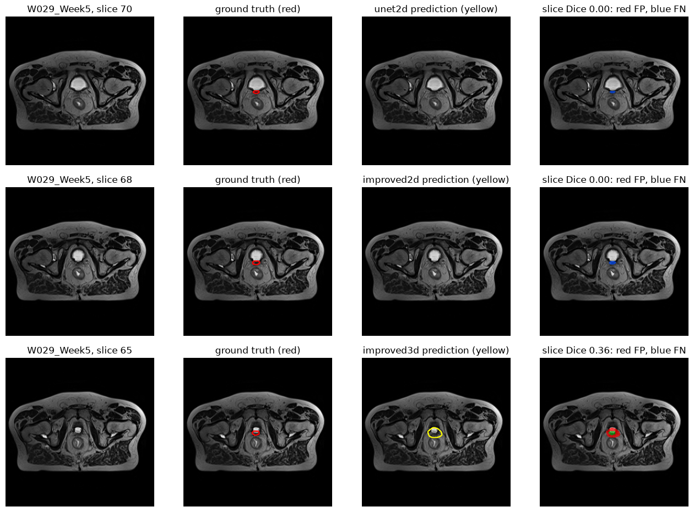
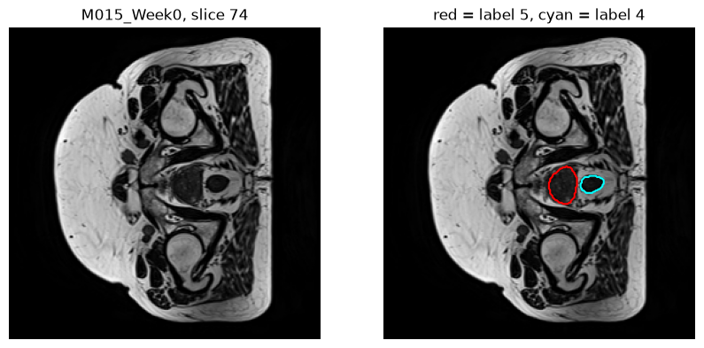
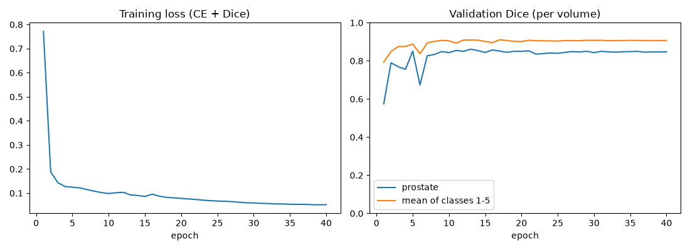
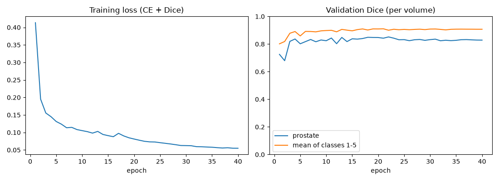
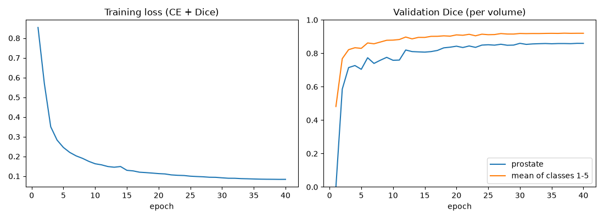
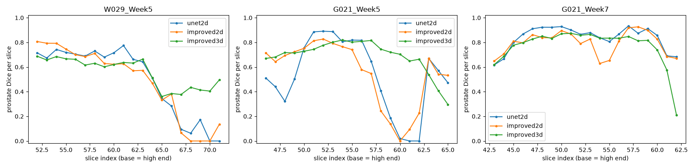
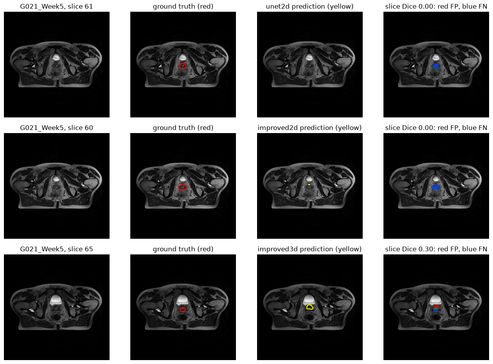
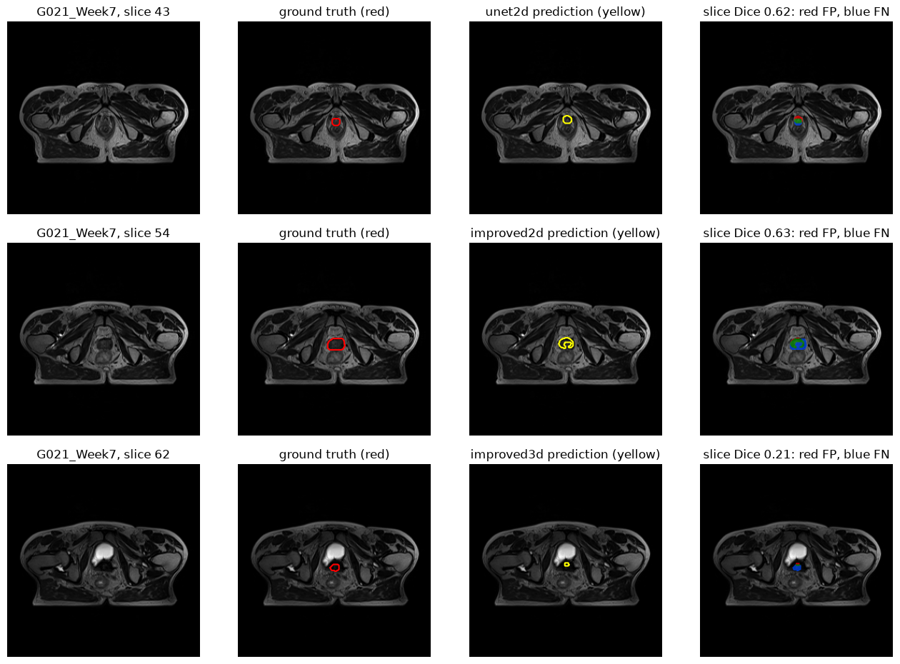
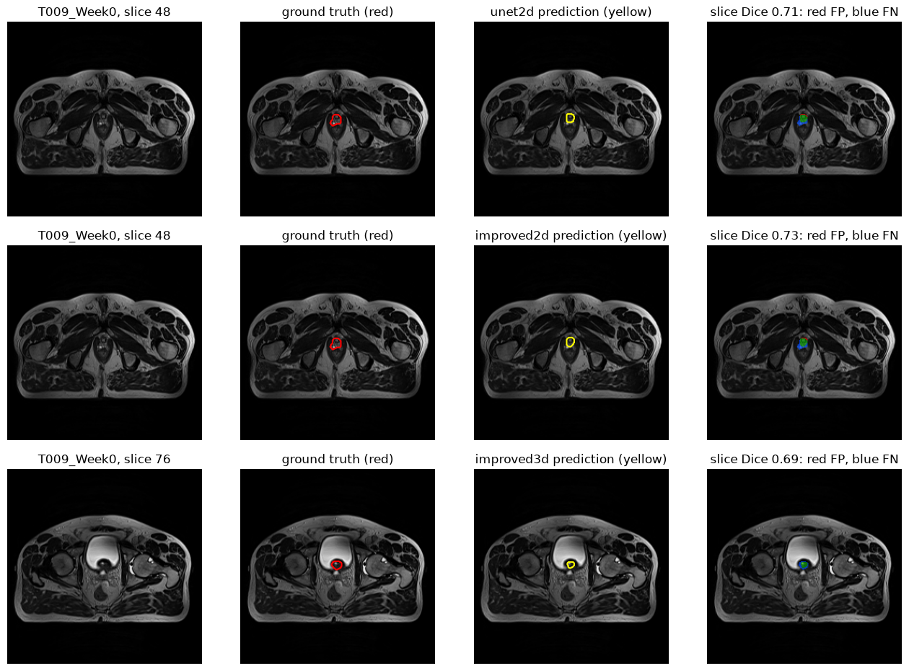

# Improved U-Net (2D and 3D) for HipMRI prostate segmentation

COMP3710 Pattern Recognition report, Section 2.2 (Segmentation) - Aaditya Puri (48956789).
Chosen model: **3D Improved U-Net** (Hard difficulty), benchmarked against a **2D U-Net baseline** (plus an extra 2D Improved U-Net) on the HipMRI prostate MRI data.

## Contents

1. [Problem and algorithm](#1-problem-and-algorithm)
2. [Feasibility review](#2-feasibility-review)
3. [Data, pre-processing and splits](#3-data-pre-processing-and-splits)
4. [Models and training](#4-models-and-training)
5. [Dependencies, reproducibility and how to run](#5-dependencies-reproducibility-and-how-to-run)
6. [Results: benchmark against the baseline](#6-results-benchmark-against-the-baseline)
7. [Investigation of the open research dilemma](#7-investigation-of-the-open-research-dilemma)
8. [Failure case autopsies](#8-failure-case-autopsies)
9. [Recommendation to the project manager](#9-recommendation-to-the-project-manager)
10. [Limitations](#10-limitations)
11. [Artificial Intelligence Usage Disclosure](#11-artificial-intelligence-usage-disclosure)
12. [References and data acknowledgement](#12-references-and-data-acknowledgement)

## 1. Problem and algorithm

**The problem.** In prostate radiotherapy the prostate must be outlined on an MRI so the dose can be aimed at it and kept away from the rectum and bladder. Doing this by hand takes a specialist a long time, so an annotation assistant that proposes the outlines for the specialist to correct would save time. The task is *semantic segmentation*: label every voxel of a pelvic MRI as background, body, bone, bladder, rectum or prostate. The prostate is tiny (about 0.08% of voxels), so the main difficulty is finding it and placing its boundary, especially at the **base** (the end next to the bladder) and the **apex** (the far end).

**How the algorithm works.** A U-Net is an encoder-decoder network. The encoder repeatedly shrinks the image, which lets deeper layers see a wide area (context) and decide *what* is where. The decoder grows the image back to full size, and skip connections copy the encoder's fine detail across so that boundaries are sharp [1]. The **Improved U-Net** [2] changes the building blocks: stride-2 convolutions instead of pooling, residual "context modules" (two convolutions with dropout in between, plus a shortcut that adds the input back), instance normalisation, leaky ReLU, and *deep supervision*, where class-score maps from the last three decoder levels are upsampled and summed so that early layers get a short path to the loss. The same class builds a **2D** version (one slice at a time) or a **3D** version (the whole volume at once, using 3D convolutions [4], so each prediction can use the slices above and below). The networks are trained with a loss that adds cross-entropy to a soft Dice loss, so that the tiny prostate cannot be ignored.

**The question this report answers.** Does true 3D context actually remove the dangerous errors at the base and apex of the prostate and the slice-to-slice errors that a 2D model makes, or does it only smooth the easy central slices while costing much more GPU memory and time?



**Key findings (three training seeds per main model, same patient-level split):**

- Mean test prostate Dice: 3D Improved U-Net **0.767 +- 0.030**, 2D U-Net baseline **0.723 +- 0.036**, 2D Improved U-Net 0.693 +- 0.026. The target of 0.70 for the 3D model was reached in all three runs.
- The benefit of 3D is concentrated at the **base** of the prostate: base-third Dice 0.694 +- 0.018 (3D) vs 0.575 +- 0.086 (baseline). The middle third improves a little (0.826 vs 0.790) and the apex does not improve (0.783 vs 0.795).
- Bladder leakage falls from 1.88% to 0.31% of predicted prostate voxels.
- 3D needs about 4.8x the peak training memory (15.2 GB vs 3.2 GB) and 2.6-3.3x the training time, but inference is not slower (0.15 s vs 0.17 s per volume).
- 3D does **not** make the base tip safe: the last few slices next to the bladder still fail, so a human must check them.

## 2. Feasibility review

*This section is the one-page feasibility review from Section 3 of the task sheet, included unchanged.*

### 2.1 User need, scope and acceptance criteria

**User:** a radiotherapy planner who checks and corrects automatic outlines of the prostate on MRI before treatment. An outline that is too small risks under-treating the tumour; one that is too large irradiates the rectum and bladder.

**Prototype purpose and dilemma:** to test whether 3D context removes the boundary and slice-transition errors a 2D model makes at the prostate's base and apex, or only smooths easy central slices at 5-10x the cost.

**Scope:** prostate segmentation on HipMRI only, comparing 2D and 3D models on a held-out test set of six patients. Clinical validation, other organs and dose planning are out of scope.

| # | Acceptance criterion |
|---|---|
| 1 | 3D prostate Dice >= 0.70 on held-out patients (per volume) |
| 2 | 3D base-third Dice higher than the 2D baseline's |
| 3 | Predicted prostate on true rectum or bladder < 1% of predicted voxels |
| 4 | Peak training memory < 40 GB (one A100) and < 3.5 h per run |

### 2.2 Model choice and course concepts

**Dataset and model:** the downsampled HipMRI 3D data the specification requires (semantic_MRs and semantic_labels_only: 211 volumes from 38 patients, 256 x 256 x 128 voxels). **3D Improved U-Net, Hard difficulty**, compared with a 2D U-Net baseline trained on slices from the same patient-level split.

**How course concepts and literature support these choices:**

- **Learned convolutional features.** A CNN learns its filters from data and stacks them into a hierarchy, from edges to organ shapes. Segmentation needs wide context to recognise the prostate and fine detail to place its boundary.
- **Encoder-decoder with skip connections** (Ronneberger et al. 2015 [1]). The encoder shrinks the image to gather context and the decoder restores resolution. Skip connections pass fine detail across, which sharpens boundaries, and the base and apex boundaries are what the dilemma is about.
- **3D convolution** (Cicek et al. 2016 [4]). Kernels span neighbouring slices, so the model can use inter-slice continuity that a 2D model cannot.
- **Residual context modules and deep supervision** (Isensee et al. 2018 [2]). Residual connections ease the training of a deeper network, and summing segmentation maps from several decoder levels gives earlier layers a short path to the loss. Instance normalisation suits training on one volume per step.
- **Loss design for class imbalance.** The prostate is about 0.08% of voxels, so a model can reach high accuracy while missing it. Dice loss scores overlap per class, and cross-entropy is added for stable early training.
- **Evaluation hygiene.** Scans of one patient are near-duplicates, so the split is by patient to prevent leakage.

### 2.3 Preliminary feasibility evidence

- **Data audit:** 211 volumes from 38 patients; median prostate 31 mL (range 8-99), spanning about 25 of 128 slices. Split by patient into 153/30/28 volumes (26/6/6 patients).
- **Test Dice per volume:** 2D U-Net baseline 0.748, 2D Improved U-Net 0.702, 3D Improved U-Net 0.761 (criterion 1 met). Base-third Dice 0.698 (3D) vs 0.621 (2D baseline); predicted prostate on true rectum 0.24% and bladder 0.81% of predicted voxels (criteria 2 and 3 met).
- **Resources:** baseline 26 min and 3.2 GB; 3D model 87 min and 15.2 GB (criterion 4 met); inference about 0.2 s per volume for both.

### 2.4 Risks, budget and fallback

- **Risks:** only six test patients and one run per model; the 3D run used a different learning rate and epoch count, so its gain is not a controlled test of context alone; one patient (W029) drives much of the base-third gain; criteria 2 and 3 were fixed after the main experiments.
- **Budget:** about 3 GPU hours used so far, plus about 2 for the retrain, on a shared cluster.
- **Next experiment:** retrain the 3D model with the baseline's learning rate and epoch count, to separate the effect of 3D context from tuning; then write up the failure cases and the recommendation.
- **Fallback:** if the 3D comparison is judged inconclusive, report the 2D baseline and 2D Improved results with the same analysis.


## 3. Data, pre-processing and splits

**Data.** The HipMRI Study 3D data on Rangpur (`/home/groups/comp3710/HipMRI_Study_open`): 211 pelvic T2 MRI volumes from 38 patients (`semantic_MRs`) with matching label volumes (`semantic_labels_only`). The labels were drawn in 3D by an MR physicist and contain six classes: 0 background, 1 body, 2 bone, 3 bladder, 4 rectum, 5 prostate. Volumes are read with nibabel, following the Nifti loading example in Appendix B of the task sheet. A patient can have up to 8 scans (weekly during treatment).

**Pre-processing** (`dataset.py`, function `load_case`):

1. Drop an extra trailing dimension where a file has one.
2. Centre-crop or zero-pad the slice axis to exactly 128 slices, so every volume is 256 x 256 x 128.
3. Z-score normalise the intensities of each volume (subtract its mean, divide by its standard deviation).
4. Reorder the axes to [slice, height, width], so `volume[z]` is one axial slice. The image and the label go through exactly the same steps, so they stay aligned. `images/overlay_check.png` is the visual check of this alignment.
5. Labels are one-hot encoded inside the loss and the metrics (6 channels).



For the **2D models**, each training slice is one axial slice. Training uses every slice that contains prostate plus randomly chosen prostate-free slices at a ratio of 0.25 per prostate slice, so that the model also learns what "no prostate" looks like. Validation and test use *every* slice, and the slice predictions are stacked back into whole volumes before any metric is computed. The **3D model** takes one whole volume per training step.

**Augmentation** (`dataset.py`, function `random_flip`): each sample is flipped left-right (along the height axis) with probability 0.5. Image and label are always flipped together. The flip was moved from `train.py` to `dataset.py` and checked to give identical results to the original code.

**Splits.** The split is **by patient**: no patient appears in more than one of train, validation and test. A patient's scans are near-duplicates of each other, so a random split by scan would put almost identical images in training and in test and inflate the scores. Patients are first grouped by how many scans they have (a full course of 8, a single scan, or a partial course), and each group is split separately with a fixed seed (42, 15% validation and 15% test of the patients in each group), so that all three splits get a similar mix. The result (`results/split.csv`):

| Split | Patients | Volumes |
|---|---|---|
| Train | 26 | 153 |
| Validation | 6 | 30 |
| Test | 6 (B006, G021, K018, S035, T009, W029) | 28 |

`check_no_leakage` asserts that every patient sits in exactly one split, and `test_pipeline.py` runs this check. The validation split is used only to choose the checkpoint (best validation prostate Dice). The test split is used only to evaluate that checkpoint.

## 4. Models and training

| | 2D U-Net (baseline) | 2D Improved U-Net | 3D Improved U-Net |
|---|---|---|---|
| Input | one 256 x 256 slice | one 256 x 256 slice | whole 128 x 256 x 256 volume |
| Channels | 32 to 512 (depth 4) | 32 to 512 (depth 5) | 16 to 256 (depth 5) |
| Normalisation, activation | batch norm, ReLU | instance norm, leaky ReLU (0.01) | instance norm, leaky ReLU (0.01) |
| Down / up sampling | max-pool / transposed convolution | stride-2 convolution / nearest upsampling + convolution | same as 2D Improved |
| Residual context modules | no | yes (dropout 0.3) | yes (dropout 0.3) |
| Deep supervision | no | yes (3 heads, summed) | yes (3 heads, summed) |
| Parameters | 7.76 M | 11.08 M | 8.27 M |
| Optimiser | Adam, lr 1e-3, cosine annealing | same | Adam, cosine annealing; lr 1e-3, 40 epochs (matched), or lr 5e-4, 50 epochs (first run) |
| Epochs, batch | 40, 16 slices | 40, 16 slices | 40 or 50, 1 volume |
| Seeds | 0, 1, 2 | 0, 1, 2 | 0, 1, 2 (matched settings) |

**Loss** (`train.py`): cross-entropy plus soft Dice loss, added with equal weight. The Dice term [3] is averaged over the five foreground classes (background excluded) and pools over the batch and all spatial axes. Deep supervision enters through the network: the three segmentation heads are summed into one output, and one loss is applied to it.

**Which 3D run is the headline?** The baseline was trained with lr 1e-3 for 40 epochs, but the first 3D run used lr 5e-4 for 50 epochs. That left open whether the 3D gain came from 3D context or from different tuning, so the **matched-settings** 3D run (lr 1e-3, 40 epochs, as in the baseline) was planned as the controlled comparison. It is the headline 3D result, repeated with three seeds. The first 3D run is reported as a secondary result, and the failure analysis in Sections 7.2 and 8 was done on that first run (its test Dice, 0.761, is within seed noise of the matched runs).

**Model selection and evaluation.** The checkpoint with the best validation prostate Dice is kept, then evaluated once on the test split. All metrics are computed **per volume** (the 128 slices of a scan are pooled before Dice or IoU are computed) so that 2D and 3D models are compared on the same basis.

## 5. Dependencies, reproducibility and how to run

**Environment (exact versions).** Python 3.14.6, PyTorch 2.14.0 (built for CUDA 13.0), NumPy 2.5.3, Matplotlib 3.11.2, nibabel 5.4.2, tqdm 4.68.2, Pillow 12.3.0 (see `requirements.txt`). All training ran on one NVIDIA A100 on the UQ Rangpur cluster through Slurm.

**Reproducibility.** The split is fixed (seed 42) and training seeds are set for Python, NumPy and PyTorch. GPU training is still not bit-for-bit repeatable, so the main models were trained with three seeds and the results are reported as mean +- standard deviation over those seeds. The standard deviation uses only three runs, so it is a rough guide.

**Files** (the five required files, then helpers):

| File | Purpose |
|---|---|
| `modules.py` | `UNet2D` baseline and `ImprovedUNet` (2D or 3D through `dim`); PyTorch only |
| `dataset.py` | patient-level split, leakage check, loading, pre-processing, 2D and 3D datasets, augmentation |
| `train.py` | training, validation, testing, saving the best checkpoint, loss and metric plots |
| `predict.py` | loads a checkpoint, predicts whole test volumes, per-class Dice and IoU, Dice by prostate third, leakage, timing, four-panel figures |
| `summarise.py`, `count_params.py` | result tables (mean +- std over seeds) and parameter counts |
| `failure_modes.py`, `slice_profile.py`, `make_autopsy_figures.py` | failure analysis (Section 8) |
| `test_pipeline.py` | self-checks: no leakage, flip keeps image and label aligned, output shapes of all models, Dice loss behaviour |
| `audit_all_volumes.py`, `explore_one_volume.py`, `check_overlay.py`, `probe_3d_memory.py` | data audit, sanity checks and the 3D memory estimate used in the feasibility review |
| `*.sh` | Slurm job scripts (`run_train.sh`, `run_predict.sh`, `analyse_all.sh` and the per-model scripts) |
| `results/`, `images/` | CSV results and figures (checkpoints and data are not committed) |

**How to run** (from this folder, on Rangpur; the data path is set at the top of `dataset.py`):

```bash
python dataset.py                                   # build and save the patient-level split (results/split.csv)
python test_pipeline.py                             # quick self-checks, no GPU needed

# training (each writes checkpoints/, results/ and images/ files named after the model and --tag)
python train.py --model unet2d --epochs 40                                       # 2D U-Net baseline
python train.py --model improved2d --epochs 40                                   # 2D Improved U-Net
python train.py --model improved3d --base3d 16 --epochs 40 --lr 1e-3 --tag matched   # 3D, matched settings
python train.py --model unet2d --epochs 40 --seed 1 --tag s1                     # a repeat with another seed

# inference and analysis on the test split
python predict.py --model improved3d --tag matched --analyse                     # per-class Dice/IoU, thirds, leakage, timing
python predict.py --model improved3d --tag matched --figures W029_Week5          # four-panel figure of the worst slice

python summarise.py                                 # tables over all runs -> results/summary.md
```

On the cluster, training and analysis are submitted with Slurm, for example `sbatch --job-name=NAME --time=02:30:00 run_train.sh --model improved3d ...`. The login node has no GPU.

## 6. Results: benchmark against the baseline

All numbers are on the same held-out test split (6 patients, 28 volumes). Dice and IoU are computed per volume and averaged. "+- std" is the standard deviation over three training seeds.

### 6.1 Test prostate Dice

| Model | Dice per run (seed 0, 1, 2) | Mean +- std |
|---|---|---|
| 2D U-Net (baseline) | 0.748, 0.682, 0.739 | 0.723 +- 0.036 |
| 2D Improved U-Net | 0.702, 0.664, 0.714 | 0.693 +- 0.026 |
| **3D Improved U-Net (matched settings)** | 0.768, 0.737, 0.797 | **0.767 +- 0.030** |
| 3D Improved U-Net (first run: lr 5e-4, 50 epochs) | 0.761 | one run |
| 2D Improved U-Net (lr 5e-4 variant) | 0.699 | one run |

The 3D model's mean is 0.044 above the baseline's. The runs still overlap (the worst 3D run, 0.737, is below the best baseline run, 0.748), so the overall gain is real on average but modest. The extra 2D Improved U-Net did not beat the plain U-Net, and trying a lower learning rate did not change that. We did not find the cause.

### 6.2 Prostate Dice per test patient (mean over the three seeds)

| Model | B006 | G021 | K018 | S035 | T009 | W029 |
|---|---|---|---|---|---|---|
| 2D U-Net (baseline) | 0.795 | 0.697 | 0.779 | 0.807 | 0.903 | 0.643 |
| 2D Improved U-Net | 0.725 | 0.671 | 0.718 | 0.801 | 0.887 | 0.644 |
| 3D Improved U-Net (matched) | 0.862 | 0.794 | 0.797 | 0.776 | 0.918 | 0.667 |

The 3D model beats the baseline on 5 of the 6 test patients (all except S035). W029 is the hardest patient for every model.

### 6.3 Dice by prostate third, and leakage onto the rectum and bladder

The true prostate's slices are split into three equal parts. The **base** is the end next to the bladder, found from the labels themselves (the end of the prostate nearer to the bladder's mean slice position), so the result does not depend on image orientation metadata. "Leak" is the percentage of the model's predicted prostate voxels that lie on the true rectum or true bladder.

| Model | Base | Middle | Apex | Leak on rectum | Leak on bladder |
|---|---|---|---|---|---|
| 2D U-Net (baseline) | 0.575 +- 0.086 | 0.790 +- 0.031 | 0.795 +- 0.030 | 0.31% | 1.88% |
| 2D Improved U-Net | 0.539 +- 0.070 | 0.765 +- 0.022 | 0.785 +- 0.027 | 0.58% | 1.62% |
| **3D Improved U-Net (matched)** | **0.694 +- 0.018** | 0.826 +- 0.030 | 0.783 +- 0.045 | 0.30% | **0.31%** |
| 3D Improved U-Net (first run) | 0.698 | 0.808 | 0.796 | 0.24% | 0.81% |
| 2D Improved U-Net (lr 5e-4) | 0.567 | 0.755 | 0.798 | 0.31% | 0.93% |

### 6.4 Per-class Dice / IoU (mean over the runs analysed)

| Model | bladder | rectum | prostate | bone | body | background |
|---|---|---|---|---|---|---|
| 2D U-Net (baseline) | 0.900 / 0.825 | 0.820 / 0.702 | 0.723 / 0.577 | 0.911 / 0.836 | 0.980 / 0.960 | 0.996 / 0.992 |
| 2D Improved U-Net | 0.861 / 0.772 | 0.798 / 0.669 | 0.693 / 0.541 | 0.911 / 0.837 | 0.976 / 0.953 | 0.994 / 0.989 |
| **3D Improved U-Net (matched)** | 0.886 / 0.813 | 0.836 / 0.723 | **0.767 / 0.634** | 0.914 / 0.842 | 0.984 / 0.968 | 0.998 / 0.996 |
| 3D Improved U-Net (first run) | 0.922 / 0.863 | 0.832 / 0.716 | 0.761 / 0.625 | 0.920 / 0.852 | 0.985 / 0.971 | 0.998 / 0.996 |

The prostate is by far the hardest class for all models. The 3D model's prostate IoU is 0.634 vs 0.577 for the baseline. The bladder is the one class where the baseline is as good as or better than the matched 3D runs (0.900 vs 0.886), although the first 3D run reached 0.922, so the difference between runs is as large as the difference between models.

### 6.5 Resource profile

Peak memory is the peak GPU memory during training (one batch of 16 slices for the 2D models, one whole volume for the 3D model), measured with PyTorch. Inference time is the time to predict one whole test volume on the A100, averaged over the test volumes and runs. Peak memory *during inference* was not measured.

| Model | Parameters | Peak training memory | Training time | Inference per volume |
|---|---|---|---|---|
| 2D U-Net (baseline) | 7.76 M | 3.2 GB | 26.2 min (40 epochs) | 0.17 s |
| 2D Improved U-Net | 11.08 M | 5.3 GB | 43.1 min (40 epochs) | 0.20 s |
| 3D Improved U-Net (matched) | 8.27 M | 15.2 GB | 68.7 min (40 epochs) | 0.15 s |
| 3D Improved U-Net (first run) | 8.27 M | 15.2 GB | 86.9 min (50 epochs) | 0.16 s |

Wall-clock times of repeat runs differ by up to about 45% between identical runs (for example 26-38 minutes for the baseline), so the times are indicative. Compared with the baseline, the 3D model needs about 4.8x the peak training memory and 2.6x (matched) to 3.3x (first run) the training time, which is below the 5-10x warned about in the task sheet. It has fewer parameters than the 2D Improved U-Net: its cost is the memory for its feature maps, not the size of the model.

### 6.6 Training curves

| 2D U-Net (baseline) | 2D Improved U-Net | 3D Improved U-Net (matched) |
|---|---|---|
|  |  |  |

## 7. Investigation of the open research dilemma

**The question** (from the task sheet): does true 3D volumetric context genuinely remove the hazardous boundary and slice-transition errors at the base and apex of the prostate and at the rectum and bladder, compared with a 2D baseline, or does it only smooth easy central slices at 5-10x the cost?

### 7.1 Acceptance criteria from the feasibility review

| # | Criterion | Result (3D matched, mean over 3 seeds unless stated) | Met? |
|---|---|---|---|
| 1 | 3D prostate Dice >= 0.70 | 0.767 (every run: 0.737, 0.768, 0.797) | yes |
| 2 | 3D base-third Dice above the 2D baseline | 0.694 vs 0.575 | yes |
| 3 | Predicted prostate on true rectum or bladder < 1% of predicted voxels | rectum 0.30%, bladder 0.31% (the baseline's bladder leakage, 1.88%, exceeds 1%) | yes |
| 4 | Peak training memory < 40 GB and < 3.5 h per run | 15.2 GB, 69-87 min | yes |

Criteria 2 and 3 were fixed after the first experiments, so they are less independent than criteria 1 and 4.

### 7.2 Where does 3D help, and where does it not?

- **Base third: clear gain.** Base-third Dice rises from 0.575 to 0.694, and it is much more consistent across seeds (std 0.018 vs 0.086).
- **Middle third: small gain** (0.790 to 0.826).
- **Apex third: no gain.** The 3D model is not better than the baseline (0.783 vs 0.795, within the seed spread).
- **Leakage:** rectum leakage is small for all models. Bladder leakage drops from 1.88% to 0.31%.

The slice-level counts below come from the first 3D run and the seed-0 2D runs (`results/failure_modes.txt`). A slice counts as a **dropout** when the prediction has less than 10% of the true prostate area on that slice, and as **over-segmented** when it has more than twice the true area. These two thresholds are my own, chosen to be simple.

| Prostate third | Slices | 2D U-Net: dropout / over-segmented | 2D Improved: dropout / over-segmented | 3D (first run): dropout / over-segmented |
|---|---|---|---|---|
| Base | 199 | 34 (17.1%) / 17 (8.5%) | 47 (23.6%) / 20 (10.1%) | 11 (5.5%) / 38 (19.1%) |
| Middle | 214 | 2 (0.9%) / 9 (4.2%) | 1 (0.5%) / 21 (9.8%) | 0 (0.0%) / 17 (7.9%) |
| Apex | 218 | 1 (0.5%) / 4 (1.8%) | 0 (0.0%) / 9 (4.1%) | 0 (0.0%) / 18 (8.3%) |

Volumes with a run of at least two consecutive dropout slices: 10 of 28 (2D U-Net), 12 of 28 (2D Improved), 3 of 28 (3D).

So 3D removes most of the **missing-prostate** failures, which are concentrated at the base, but it **trades them for over-sized contours**, at the base and also at the apex. Over-contouring is the error that irradiates the rectum and bladder, so the trade is not automatically good. The measured leakage is still lower for 3D, because the extra voxels are mostly not on the rectum or bladder.



### 7.3 Answer to the dilemma

3D context does more than smooth the central slices: it gives a measurable gain at the base, which is the region the dilemma is about, and it removes most missed-slice failures there. It does not remove the failures. The last slices at the base tip still go wrong (missed by 2D models, wrongly sized or shifted by the 3D model), and there is no gain at the apex. The cost is about 4.8x the training memory and 2.6-3.3x the training time, but not a slower inference.

## 8. Failure case autopsies

Each figure stacks, from top to bottom, the 2D U-Net, the 2D Improved U-Net and the 3D Improved U-Net (first run), for one test volume. Each row shows the input slice, the ground truth (red), the prediction (yellow) and the error overlay (red = false positive, blue = false negative, green = correct). Each row shows that model's lowest-Dice slice among the slices that truly contain prostate (the default of `predict.py`), so the three rows are not the same slice. Per-slice numbers come from `slice_profile.py`. The explanations of *why* are hypotheses: I did not test them.

### Case 1: W029_Week5 - the prostate tapers off at the base


The true prostate covers slices 52-71 and shrinks from 165 pixels (slice 63) to 35 pixels (slice 70) towards the base, right under the bright bladder. On slices 64-66 *every* model draws a contour 3-6x too large (true 68-113 px, predicted 285-412 px). On slices 67-71 the two 2D models predict almost nothing (0-10 px, Dice 0.00-0.17), while the 3D model keeps predicting a contour but too large (98-254 px against a true 35-62 px, Dice 0.38-0.50). **Failure types:** over-contouring then dropout (2D); persistent over-contouring (3D). **Suspected trigger:** a small, quickly tapering target next to a very bright, large structure. W029 is also the patient with the smallest prostate in the test set (at most 165 px per slice, against 343 px for G021_Week7), and that is the hardest patient for every model, but whether size is the cause was not tested.

### Case 2: G021_Week5 - a run of missed slices in the 2D models



On slices 58-62 the true prostate is *not* tiny (152-276 px), yet the 2D U-Net's Dice falls from 0.41 to 0.00 (it predicts 82, 56, 4, 0 and 0 px) and the 2D Improved U-Net predicts 3-52 px (Dice 0.00-0.24). The 3D model holds on (Dice 0.65-0.75 on the same slices). This is the clearest example of a **slice-transition error** that a slice-by-slice model makes and a volumetric model avoids. At the very last slices (63-65) the 3D model is also weak: on slice 65 it predicts about the right amount of prostate (125 px against 98 px) but shifted towards the bladder (Dice 0.30). **Suspected trigger (2D):** each slice is judged on its own, and on these slices the prostate looks like the surrounding tissue; neighbouring slices, which the 3D model can use, show where it must be.

### Case 3: G021_Week7 - three different errors in the same patient



The same patient on a later week. The 2D U-Net's worst slice (z43, the apex end, Dice 0.62) is a roughly right-sized contour that is slightly offset. The 2D Improved U-Net's worst slice (z54, Dice 0.63) is an irregular, curled contour in the middle of the gland. The 3D model's worst slice (z62, base end, Dice 0.21) is the opposite of Case 1: a small contour **inside** a larger true outline, next to the bladder. **Failure types:** offset (apex), irregular shape (middle), under-segmentation (base). This shows that the 3D model can also under-contour at the base tip.

### Case 4: T009_Week0 - a "good" patient with boundary errors



T009 is the easiest patient (mean Dice 0.90-0.92). Even here each model's worst slice reaches only Dice 0.69-0.73 (z48, z48 and z76). Nothing is missed: the prediction and the truth overlap, and the errors are a thin rim of false positive and false negative around the boundary. **Failure type:** small boundary offsets. This is the ordinary, expected error. It matters because a clinician reviewing the outline would still need to adjust it.

## 9. Recommendation to the project manager

**Should the team move the 3D Improved U-Net forward?** Yes, as a drafting tool with human review, not as an automatic contouring system.

- **Why advance it.** It is better than the 2D baseline where the baseline is weakest, at the base of the prostate (+0.12 Dice), it misses far fewer base slices, it keeps predicted prostate off the bladder (0.31% vs 1.88%), and it improves the average Dice by 0.044. Its cost is affordable: about 15 GB of memory and about 70 minutes to train on one A100, and inference takes 0.15 s per volume, no slower than the 2D models. The 5-10x cost warned about in the task sheet was not reached (about 4.8x memory and 2.6-3.3x training time).
- **What still needs a human.** (1) The last few slices at the base tip, next to the bladder: no model handled these reliably (Cases 1-3). (2) Prostates that are small or taper quickly (W029 was the hardest patient for every model; the reason was not tested). (3) The apex, where 3D gave no gain over the baseline. (4) Every outline, for boundary refinement (Case 4).
- **How to use it.** Propose the contour, and ask the clinician to review the first and last few slices of the predicted prostate and any volume where the slice-to-slice area changes abruptly. These review rules were *not* validated here and are a starting point only.
- **Before any clinical use** the evidence needs to be stronger: more patients, a second annotator, and an external test set (Section 10).

## 10. Limitations

- **Small test set.** Six test patients and one fixed split. Per-patient results vary a lot (Dice 0.64-0.92), and a single patient (W029) can move the averages. The 3D model did not win on every patient (it lost on S035).
- **Three seeds only.** The standard deviations are rough. The best baseline run (0.748) is above the worst 3D run (0.737), so "3D is better on average" is the supported claim, not "3D is always better".
- **The first 3D run and the matched runs differ in settings** (learning rate and epochs). The failure analysis (Sections 7.2 and 8) uses the first run, not the matched runs; its Dice is close to the matched runs' (0.761 vs 0.767) but the slice-level counts were not repeated for the matched runs.
- **Unexplained result.** The 2D Improved U-Net was slightly worse than the plain 2D U-Net, and a lower learning rate did not change that. We do not know why.
- **Post-hoc choices.** Acceptance criteria 2 and 3 were fixed after seeing first results, the matched retrain and the 2D lr 5e-4 variant were run after seeing test results of the first runs (all are reported in full, not selected), and the dropout and over-segmentation thresholds in Section 7.2 are my own.
- **Hypotheses not tested.** The suggested causes in Section 8 (a small tapering target next to the bladder, a missing-context explanation for 2D dropouts) are not tested.
- **Single annotator, single site.** Ground truth is one physicist's drawing, and there is no external dataset.
- **Inference memory** was not measured (only training memory).

## 11. Artificial Intelligence Usage Disclosure

**Tools used.** Claude (Anthropic) was used throughout this project, as a chat assistant and as a coding assistant.

**What it helped with.**

- Planning the project and explaining concepts (U-Net, Dice loss, 3D convolution, class imbalance, Slurm and Git workflow).
- Drafting and revising code: the data loader and split, the model definitions, the training script, the analysis and plotting scripts, the Slurm job scripts and the self-check tests.
- Debugging (cluster job errors, Git push problems, shell quoting).
- Drafting and editing this README and the feasibility review, and suggesting the structure of the failure-case analysis.

**How I checked it.** I ran every script on the Rangpur cluster and inspected the outputs rather than trusting the generated code. The specific checks were:

- the image/label alignment was checked visually (`images/overlay_check.png`);
- the patient-level split is checked by an assertion (`check_no_leakage`) and by `test_pipeline.py`;
- when the augmentation was moved from `train.py` to `dataset.py`, I confirmed on random data that the new function gives identical output to the old code, and ran a one-epoch end-to-end training job afterwards;
- peak GPU memory was measured with a dedicated probe (`probe_3d_memory.py`) and during training, not estimated;
- every number in the results tables is generated from the CSV files by `summarise.py`, not typed by hand;
- repeated runs with three seeds were run to check how much the results change by chance.

## 12. References and data acknowledgement

The reference numbers follow the course task sheet where a reference appears there.

- [1] O. Ronneberger, P. Fischer, T. Brox. *U-Net: Convolutional Networks for Biomedical Image Segmentation.* MICCAI 2015.
- [2] F. Isensee, P. Kickingereder, W. Wick, M. Bendszus, K. H. Maier-Hein. *Brain Tumor Segmentation and Radiomics Survival Prediction: Contribution to the BRATS 2017 Challenge.* BrainLes 2017 (Lecture Notes in Computer Science 10670), 2018.
- [3] F. Milletari, N. Navab, S.-A. Ahmadi. *V-Net: Fully Convolutional Neural Networks for Volumetric Medical Image Segmentation.* 3DV 2016 (the Dice loss).
- [4] O. Cicek, A. Abdulkadir, S. S. Lienkamp, T. Brox, O. Ronneberger. *3D U-Net: Learning Dense Volumetric Segmentation from Sparse Annotation.* MICCAI 2016.

**Data.** The HipMRI Study data (prostate MRI volumes and segmentations, provided through the COMP3710 course) is used under its data-use agreement; the study is described at doi:10.1016/j.ijrobp.2015.08.045. Data and trained model files are not included in this repository.
